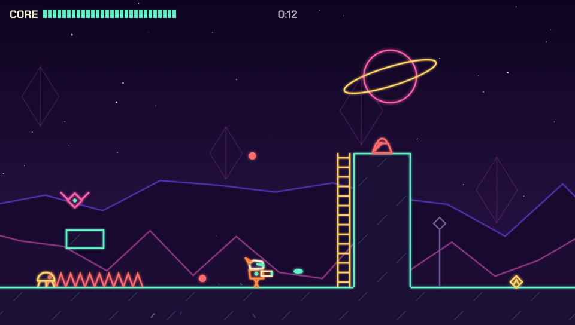
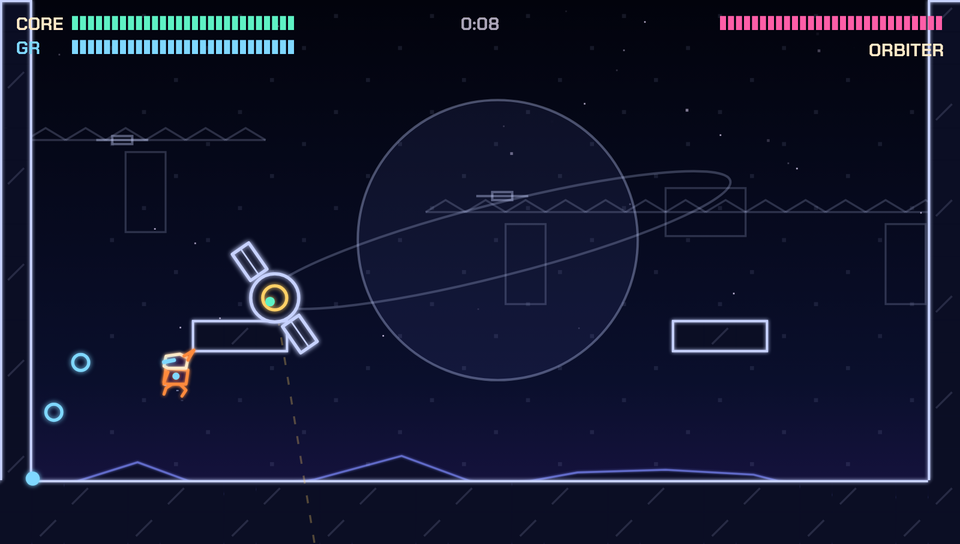
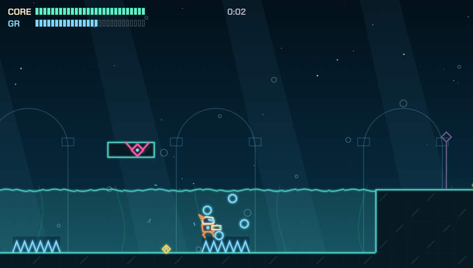
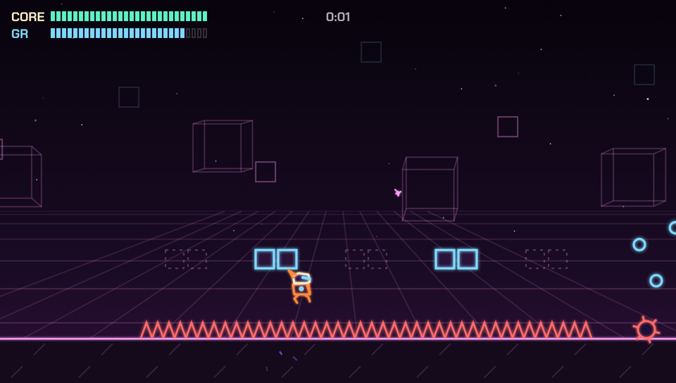
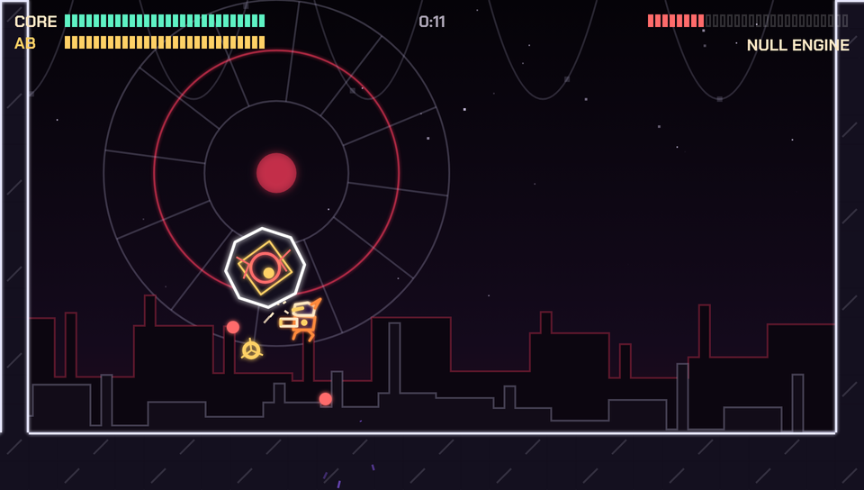
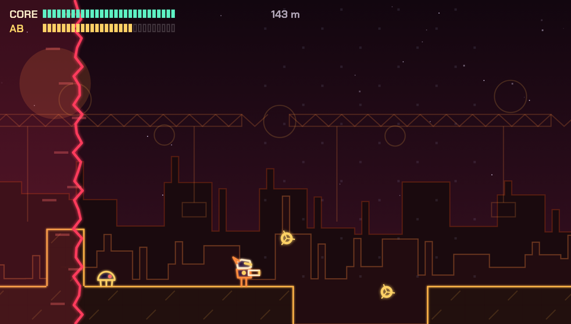
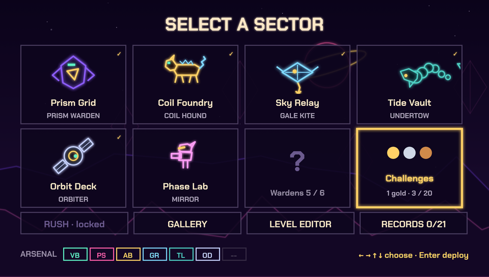
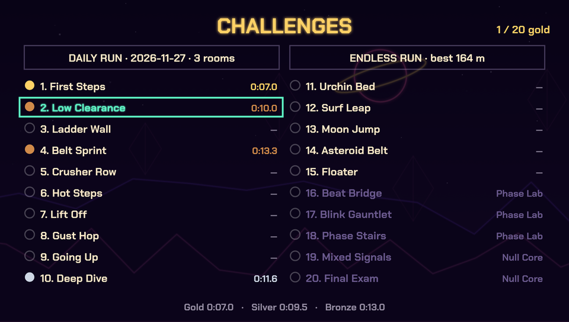

# Voltline press kit

Everything here may be used to write about or list Voltline. The game and these files are under the [MIT license](../../LICENSE).

| File | What it is |
|---|---|
| [FACTSHEET.md](FACTSHEET.md) | The facts: what it is, features, platforms, controls, credits |
| [ITCH.md](ITCH.md) | Ready-to-paste text for the itch.io page (short and long description, controls, tags) |
| `logo.png`, `logo-dark.png` | Logo, 1200×360, transparent and on the game's dark purple |
| `../../icon-512.png` | App icon, 512×512 |
| `screenshots/` | Eight 960×544 screenshots (the game's 480×272 view at 2×) |
| `voltline-30s.gif` | A 30-second gameplay montage, 480×272, 12 fps (2.7 MB) |
| `voltline-30s.mp4` | The same montage at 960×544 (0.9 MB), for places that take video |

All of it is generated from the game itself by `tools/build-press.js` (seeded runs played frame by frame in headless Chrome), so it can be rebuilt after the game changes. The montage shows Prism Grid, the Orbiter fight, Phase Lab's switching blocks, the Mirror fight and the null wave in Endless.

## Screenshots

| | |
|---|---|
|  |  |
|  |  |
|  |  |
|  |  |
